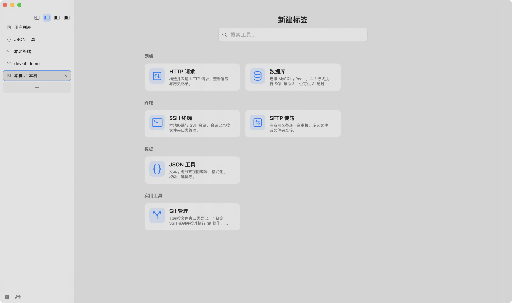
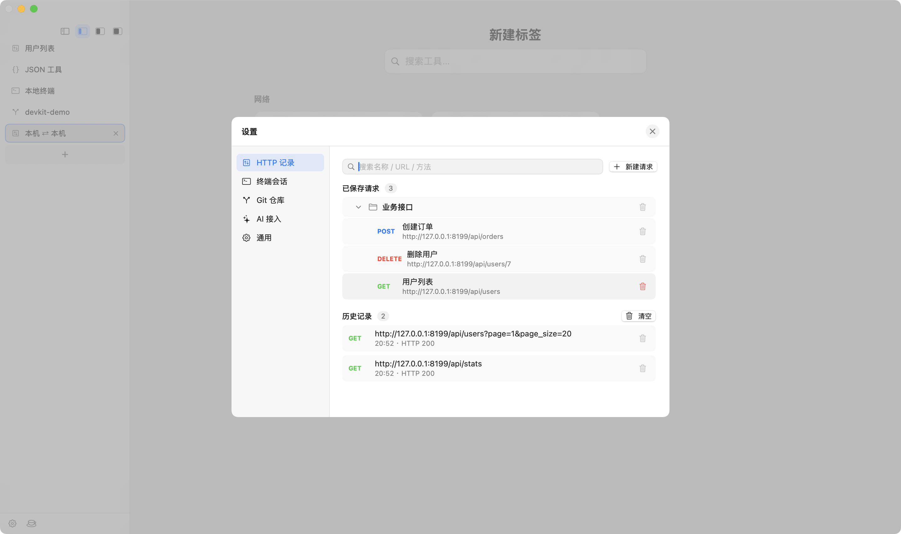
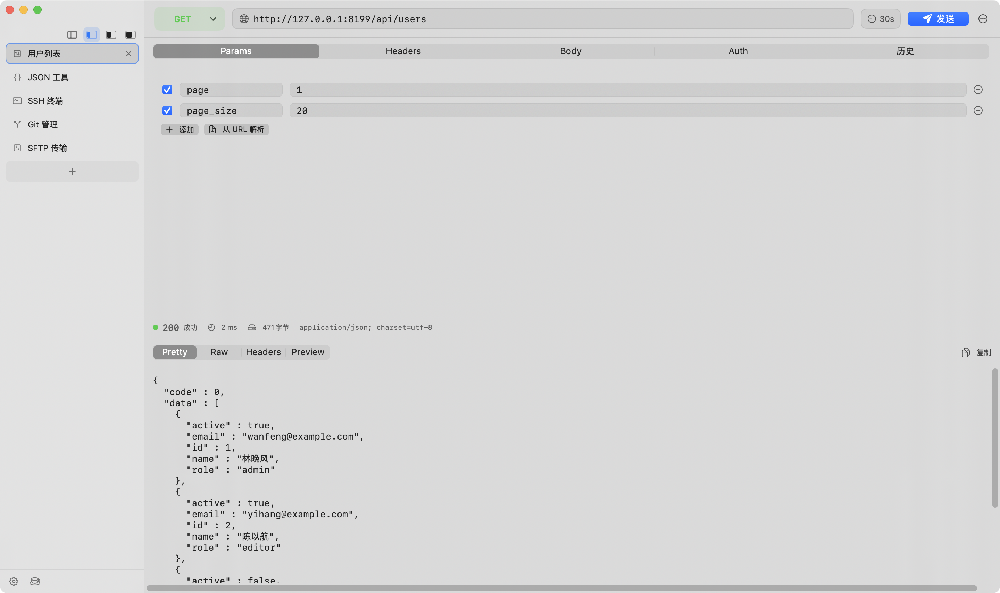
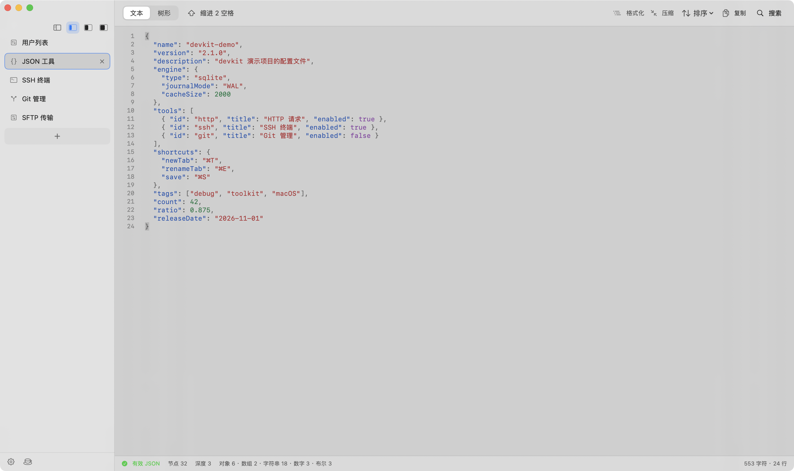
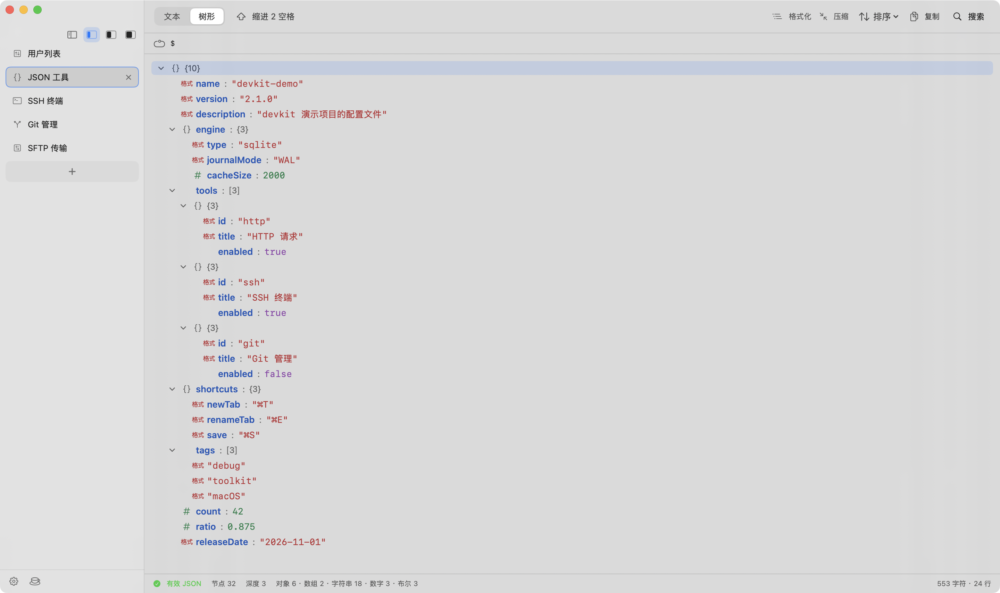
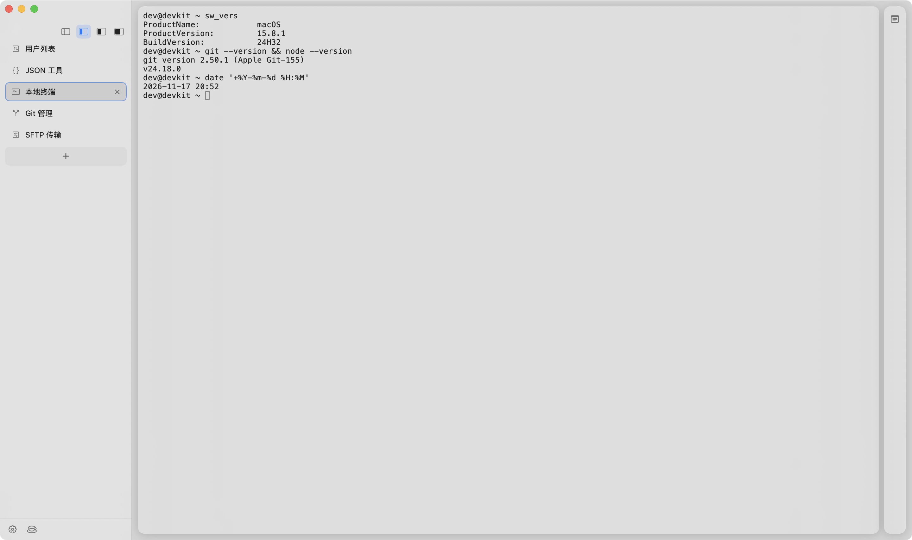
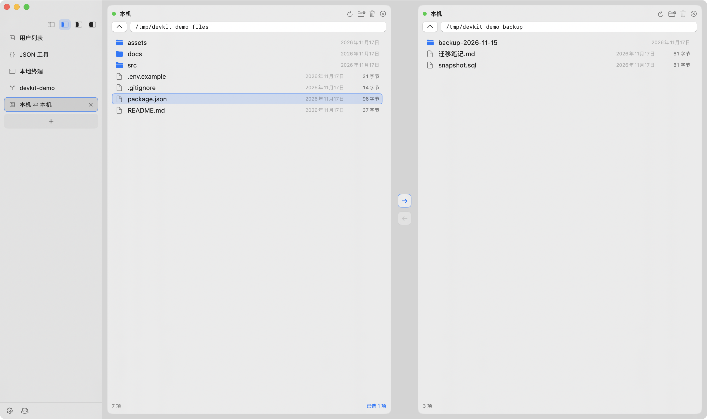
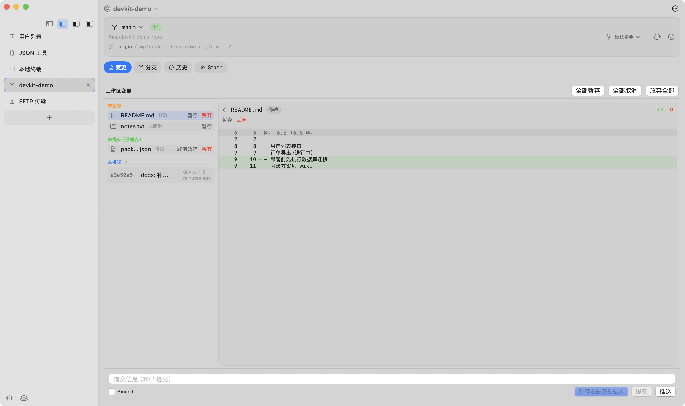

面向 macOS 开发者的本地化工具集，追求**精简、快速、低内存占用**。将日常开发中高频使用的工具聚合到一个 App 内，用标签页方式并行工作，减少在多个重量级应用之间切换的开销。

> 内存太贵，只能用精简应用了。



截图均来自真实运行的应用，演示数据为虚构内容。

## 应用外壳

一个标签 = 一个工具实例，可多实例并行、分组折叠、拖拽排序。⌘T 打开新标签页（上图），工具按「网络 / 终端 / 数据 / 实用工具」分类展示，顶部搜索框可按名称 / 描述 / 分类过滤。

- **会话快照**：重启后自动还原已打开的标签及各工具内部状态（请求内容、编辑文本、视图模式、连接绑定等）
- **标签管理**：分组折叠、自定义标题、双击重命名、Chrome 风格拖拽排序；关闭有未保存内容的标签会二次确认
- **外观**：跟随系统 / 浅色 / 深色三档切换，全局生效（含终端 ANSI 配色与毛玻璃材质）；另可开启「简约模式」——去除透明模糊，界面改为扁平黑白灰（功能状态色保留）
- **防休眠**：侧栏底部咖啡杯开关，同时防屏保与系统休眠
- **快捷键**：⌘T 新标签 · ⌘1~9 直达第 N 个标签 · ⌃↓/⌃↑ 切换标签 · ⌘E 重命名 · ⌘S 保存 · ⌘W 关闭
- **设置面板**（⌘,）：HTTP 记录 / 终端会话 / Git 仓库 / 数据库 / AI 接入 / 通用统一管理——关键字搜索、文件夹树形浏览、记录移动 / 编辑 / 删除、数据目录查看与迁移、备份恢复（配置压缩包导出 / 导入）；终端会话 / Git 仓库 / 数据库记录均可按条控制是否由 MCP 提供与是否脱敏（支持全部开启 / 关闭）



## HTTP 请求

构造并发送 HTTP 请求，查看响应与历史记录。



- **请求编辑器**：Params / Headers / Body / Auth / 历史五个分区；参数与请求头支持单行启用 / 禁用，Body 支持 JSON / 表单 / Raw
- **鉴权**：Bearer Token 与 Basic Auth，自动生成 `Authorization` 头
- **响应查看器**：Pretty（JSON 美化）/ Raw / Headers / Preview 四视图；状态条展示状态码分类、耗时、大小、Content-Type
- **集合与历史**：请求按多级文件夹归类保存（类 Postman，⌘S）；历史自动落库，可搜索、重发、载入，历史详情独立弹窗
- **实用细节**：按请求设置空闲超时（SSE 流式接口友好）、发送中可随时停止、一键复制为 cURL、响应体 10 MB 封顶并显式提示

## JSON 工具

文本 / 树形双视图编辑、格式化、校验、键排序。



- 语法高亮编辑器：行号、括号配对与匹配高亮、引号 / 括号自动跳过、回车自动缩进
- 格式化 / 压缩 / 校验 / 键排序（升序 / 降序 × 递归 / 仅顶层），缩进可选 2 / 4 空格或 Tab
- 手写递归下降解析器，错误提示精确到行列（尾逗号、单引号等）



- **树形视图**：折叠展开、路径面包屑定位、复制子树
- 底部状态栏统计节点数、最大深度与类型分布；内容随会话快照留存，重启原样还原

## SSH 终端

本地终端与 SSH 会话，连接配置按文件夹归类管理。



- **本地终端**：一键进入本机 shell，可记录默认进入的目录（打开即落位）
- **远程双引擎**：密码认证进程内 NIOSSH 直连（无需本机 ssh）；私钥认证走系统 `ssh`，原生支持 RSA、口令与 known_hosts
- **会话记录库**：主机 / 端口 / 用户名 / 认证方式 / 远端默认目录存 SQLite，按文件夹归类；登录成功后自动 `cd` 到默认目录
- **记事本**：右缘工具条展开，常用命令片段按会话记录分类，一键发送到当前终端
- 断开后一键重连；重启还原的远程会话默认「已断开」，点击才连接

## SFTP 传输

左右两区各连一台主机，多选文件或文件夹双向互传。



- 一个标签 = 左右两个文件面板，支持**本地↔本地 / 本地↔远端 / 远端↔远端**任意组合
- 多选文件 / 文件夹递归互传；request-id 并发流水线提升小文件吞吐，实时显示整体字节进度与文件计数，可取消
- 面板内直接管理文件：新建文件夹、删除、刷新、路径栏跳转、返回上级
- 传输经本地临时文件中转（源下载 → 目标上传），失败 / 取消横幅自动消失

## Git 管理

仓库按文件夹归类登记，绑定 SSH 密钥并按 key 执行 git 操作，支持跨设备复用密钥。



- **工作区变更**：冲突 / 未暂存 / 已暂存 / 未推送四组，冲突置顶；点击文件在右侧看逐行着色的 unified diff；提交栏支持 ⌘↵ 提交与 Amend
- **分支与历史**：新建 / 切换 / 合并 / 删除分支；提交历史分页加载，右键 Cherry-pick、重置（soft / mixed / hard）、复制哈希
- **远程操作**：fetch / pull / push（含「拉取后自动推送」）后台静默执行；远程地址可就地编辑
- **冲突解决**：冲突块逐块「保留我方 / 保留对方」，全部标记后自动 `git add`
- **进阶操作**：Stash、rebase（含中止）、cherry-pick、reset、tag，均带输出控制台
- **公钥管理**：`ssh-keygen` 生成（Ed25519 / RSA）或导入密钥；密钥落盘于应用数据目录，指向同步盘即可跨设备复用

## 数据库

连接 MySQL / Redis，命令行式执行 SQL 与命令。

- **连接管理**：MySQL 与 Redis 统一登记存 SQLite，类型切换端口联动默认值（3306 / 6379）
- **命令行式执行**：MySQL 多语句返回 TSV 表格文本；Redis 按行执行，结果按 redis-cli 风格渲染（`(integer)` / `(nil)` / 数组缩进）
- **零依赖直连**：MySQL 走 mysql-nio（无需本机客户端），Redis 手写 RESP2 协议
- 输出区按方向着色（输入 / 结果 / 错误），时间戳、自动滚动、一键清空；连接别名可供 AI 经 MCP 引用

## AI 接入（MCP）

内置 MCP（Model Context Protocol）服务器，让 ZCode / Claude Code / Cursor 等大模型客户端直接使用 devkit 已保存的服务器连接与 Git 密钥执行任务，而 **密码、密钥路径永远不会进入模型上下文**。默认关闭，在「设置 → AI 接入」中启用。

- 客户端经自动生成的 stdio 桥接脚本接入，配置只需 command + args
- 对外 10 个工具：SSH 会话（`ssh_list_servers` / `ssh_open_session` / `ssh_exec` / `ssh_close_session`）、Git（`git_list_repos` / `git_status` / `git_run`）、数据库（`db_list_connections` / `db_query` / `db_command`）——模型默认只见别名，凭据在 app 进程内取用
- 远程执行支持跨命令保持 cd / 环境变量的持久会话（空闲 30 分钟回收）
- 记录级访问控制：设置里「终端会话 / Git 仓库 / 数据库」每个分区的每条记录都可开关「是否由 MCP 提供」（关闭后 MCP 列表无此条、也无法直接调用），并支持全部开启 / 全部关闭
- 记录级脱敏：默认开启，IP / 用户名等经脱敏层擦除为 `[REDACTED]`；用户对个别记录关闭脱敏后，其主机 / 端口 / 用户名会出现在 MCP 列表中（密码与密钥路径仍永不输出）；设置页提供 Token 管理、客户端配置一键复制、AI 使用提示词、最近 200 次调用审计

威胁模型说明：本功能保证凭据不流经模型上下文 / 对话记录 / 云端日志（上下文卫生），不防御已在本地获得任意 shell 权限的恶意程序——后者需要操作系统级沙箱，超出范围。

## 网页版

`devkit-web/` 是同一套工具集的网页实现：标签页外壳、HTTP 请求与 JSON 工具，零依赖、零构建。

```bash
cd devkit-web && node server.js
# http://127.0.0.1:5173
```

浏览器直连受同源策略限制，`server.js` 内置同源代理通道（`/api/proxy`）。SSH / SFTP / Git 需要本机 shell、文件系统与密钥存储，仍保留在桌面端。详见 [devkit-web/README.md](devkit-web/README.md)。

## 技术栈

- **前端**：SwiftUI（AppKit 混合，终端等场景用 `NSViewRepresentable` 封装）
- **终端**：SwiftTerm
- **SSH / SFTP**：SwiftNIO + NIOSSH（密码认证进程内实现），私钥认证走系统 `/usr/bin/ssh` 子进程
- **数据库**：MySQL 走 mysql-nio（Swift 直连，无需本机客户端）；Redis 手写 RESP2 协议（零依赖）
- **数据存储**：SQLite（HTTP 历史、集合、SSH 连接配置等）
- **依赖管理**：Swift Package Manager；工程为 Xcode 16 同步文件夹组，新增 Swift 文件自动纳入编译

## 项目结构

```
devkit/devkit/
├── Core/            # 数据、设计令牌、模型、偏好设置
│   ├── AIAccess/    # AI 接入（MCP）：协议、HTTP 监听、工具目录、SSH 执行、脱敏、编排
│   ├── Data/        # SQLite 管理与建表
│   ├── DesignSystem/# 主题令牌、通用面板与滚动指示条
│   ├── Models/      # 工具协议、注册表、标签/分组模型
│   └── Preferences/ # 偏好键、咖啡杯防休眠、外观模式
├── Shell/           # 应用外壳：状态管理、标签/分组视图、菜单命令、设置面板
├── Tools/           # 各工具（HTTP / SSH / SFTP / Git / DB / JSON）
├── Utilities/       # 手指光标、目录选择面板、窗口配置等辅助
├── ContentView.swift
└── devkitApp.swift
```

每个工具内部按 `Logic`（协议/客户端/存储）、`Models`（数据模型）、`Views`（SwiftUI 视图）分层组织。新增工具只需实现 `DevkitTool` 协议并在注册表加一行即可插拔接入。

## 构建

使用 Xcode 16 打开 `devkit/devkit.xcodeproj` 编译运行，或通过 `xcodebuild` 构建打包 dmg：

```bash
cd devkit
xcodebuild -project devkit.xcodeproj -scheme devkit -configuration Release \
  -derivedDataPath build/DerivedData -destination 'platform=macOS,arch=arm64' \
  -IDEPackageSupportDisableManifestSandbox=1 \
  -IDEPackageSupportDisablePluginExecutionSandbox=1 \
  OTHER_SWIFT_FLAGS='$(inherited) -disable-sandbox' \
  CODE_SIGN_IDENTITY="-" build
```

打包 dmg（卷名 `devkit`，内含 devkit.app 与 Applications 软链）：

```bash
rm -rf build/dmg-staging && mkdir -p build/dmg-staging
cp -R build/DerivedData/Build/Products/Release/devkit.app build/dmg-staging/
ln -s /Applications build/dmg-staging/Applications
hdiutil create -volname "devkit" -srcfolder build/dmg-staging -ov -format UDZO build/devkit.dmg
```

> 项目使用 ad-hoc 签名（无开发者证书），首次打开需右键打开或 `xattr -d com.apple.quarantine`。

`docs/screenshots/` 内的截图由 DEBUG 构建内的演示场景驱动器 `devkit/devkit/Shell/DemoShots.swift` 生成（`DEVKIT_DATA_DIR` 指向临时空目录启动，进程内注入虚构数据），用法见该文件头注释。

## 更新记录

- **2026-11-20**：新增「简约模式」——去除全部透明 / 毛玻璃效果，装饰色黑白灰化（强调色令牌化 `Theme.Palette.accent`，分组色映射灰度），功能状态色保留；设置 → 通用 → 外观开启，与明暗主题正交组合
- **2026-11-20**：MCP 访问控制与脱敏改造——设置页新增「数据库」连接管理；终端会话 / Git 仓库 / 数据库记录按条开关「是否由 MCP 提供 / 是否脱敏」（支持全部开启 / 关闭，默认脱敏）；通用设置新增「备份恢复」块（配置压缩包导出 / 导入）
- **2026-11-06**：SSH 终端新增「记事本」——命令片段按会话记录分类，一键发送到当前终端
- **2026-11-02**：Git 变更区新增「放弃修改」——一键把暂存区与工作区还原到最近一次提交，未暂存文件可按文件丢弃
- **2026-10-25**：新增「数据库」工具（MySQL / Redis 命令行式执行）与「AI 接入（MCP）」——内置 MCP 服务器，大模型客户端经 stdio 桥接脚本使用已保存的连接与密钥，凭据零暴露
