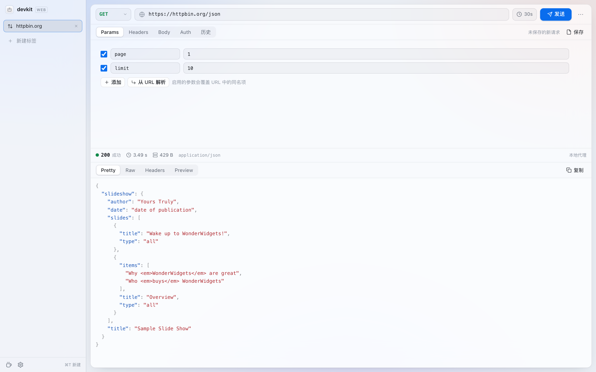
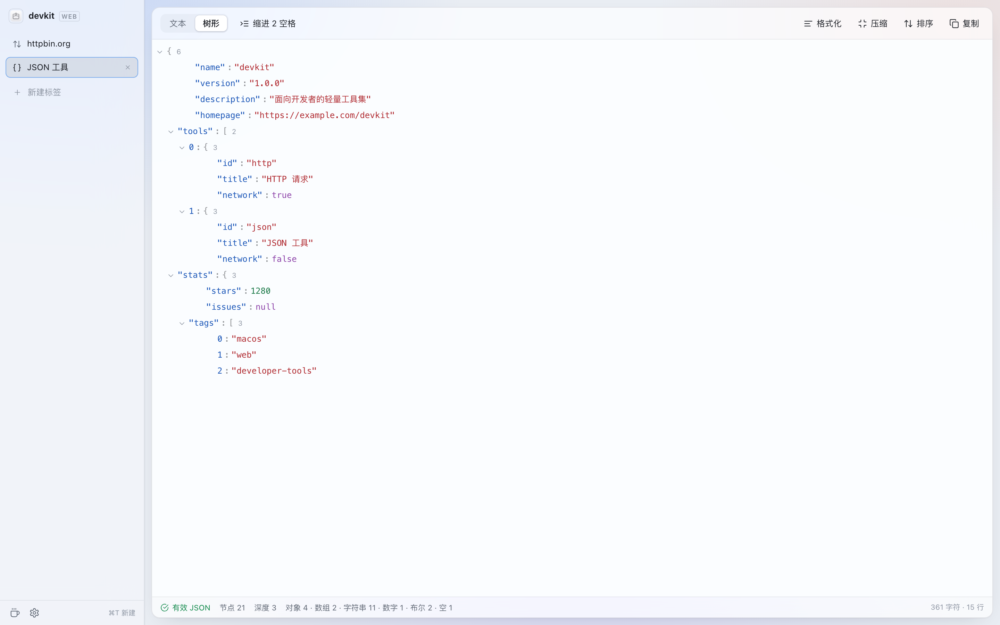

# devkit web

macOS 端 [devkit](../README.md) 的网页版：同一套「标签页外壳 + 工具」结构，一个标签 = 一个工具实例。

开源项目地址：https://github.com/LightningAndWind/Macos-Developer-Toolkit

- **零依赖、零构建**：原生 ES Modules + CSS，`node server.js` 即可运行。
- **本地优先**：会话、集合、历史全部存在浏览器本地，不上传任何数据。
- **可选本地代理**：浏览器直连受同源策略限制，`server.js` 内置 `/api/proxy` 转发通道，可发送任意请求头、读取完整响应头。





## 运行

```bash
cd devkit-web
node server.js
# http://127.0.0.1:5173
```

仅监听回环地址。端口占用时：`PORT=5174 node server.js`。

> 直接双击 `index.html` 无法工作（ES Modules 受 `file://` 限制），也不会有代理通道。

## 功能对照

| 能力 | macOS 端 | 网页端 |
| --- | --- | --- |
| 标签 / 分组 / 拖拽排序 / 重命名 | ✅ | ✅ |
| 新标签 Launcher、搜索、快捷键 | ✅ | ✅ |
| 会话快照（重启还原标签与内容） | SQLite | localStorage（标签 / 内容）+ IndexedDB（HTTP 历史） |
| 外观（跟随系统 / 浅色 / 深色） | ✅ | ✅ |
| 防休眠 | ✅（系统断言） | ✅（Screen Wake Lock API） |
| HTTP：Params / Headers / Body / Auth | ✅ | ✅ |
| HTTP：Pretty / Raw / Headers / Preview | ✅ | ✅（Preview 支持 HTML / 图片） |
| HTTP：超时、停止在途请求、10 MB 封顶 | ✅ | ✅（空闲超时语义一致） |
| HTTP：历史 / 搜索 / 详情 / 重发 | SQLite | IndexedDB（最近 300 条） |
| HTTP：集合、多级文件夹、⌘S 保存 | SQLite | localStorage |
| HTTP：复制为 cURL | ✅ | ✅ |
| JSON：文本 / 树形、格式化、压缩、排序、统计 | ✅ | ✅ |
| JSON：手写解析器与中文错误定位 | ✅ | ✅（行列号一致） |
| SSH / SFTP / Git | ✅ | —（需要本机 shell / 文件系统，见应用内说明） |

## 结构

```
devkit-web/
├── index.html
├── server.js              # 静态服务 + /api/proxy
├── css/
│   ├── base.css           # 设计令牌、通用控件
│   ├── shell.css          # 侧栏、Launcher、设置、弹层
│   └── tools.css          # HTTP / JSON
└── js/
    ├── main.js
    ├── shell.js           # 标签、分组、拖拽、快捷键、主题
    ├── settings.js
    ├── store.js           # 会话与集合持久化
    ├── ui/                # DOM / 图标 / 浮层
    └── tools/
        ├── registry.js
        ├── http/          # model / client / history / view
        └── json/          # parser / highlight / view
```

## 快捷键

`⌘T` 新建标签 · `⌘W` 关闭 · `⌘1~9` 切换 · `⌃↑/⌃↓` 前后切换 · `⌘E` 重命名 · `⌘S` 保存请求 · `⌘↵` 发送 · `⌘,` 设置

Windows / Linux 下把 `⌘` 换成 `Ctrl`。

## 浏览器限制

- 直连模式不能设置 `Host`、`Cookie`、`Content-Length` 等浏览器保留头，也不能读取未通过 CORS 暴露的响应头；界面会显式提示。
- 直连模式的 Cookie 遵循浏览器同源策略；代理通道默认不转发浏览器 Cookie。
- 响应体上限 10 MB，超出即中止接收并提示。

## 部署

静态托管即可打开界面；若需要无 CORS 限制的请求能力，需要能运行 Node 的环境（`server.js` 同时托管静态文件与代理）。不要把 `server.js` 绑定到 `0.0.0.0` 暴露为公共代理。
